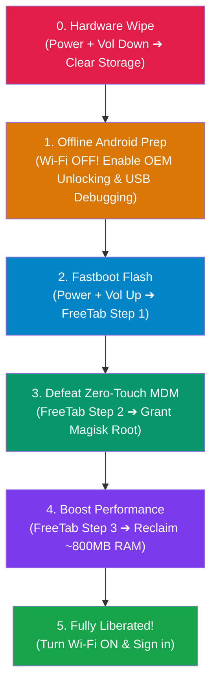

<div align="center">

# 🚀 FreeTab Pro (v2.5)
### Standalone All-in-One GUI Root, Anti-MDM Defense & Performance Suite
**Engineered specifically for Acer One 8 (T4-82L Gen 2 / Helio G85) Android 16 Tablets**

[](https://golang.org)
[](https://wails.io)
[](https://microsoft.com)
[](https://opensource.org/licenses/MIT)
[-orange)](#)

</div>

---

## 📖 Overview

**FreeTab** is a standalone, single-executable desktop utility designed to completely liberate the **Acer One 8 (T4-82L Gen 2)** tablet (widely distributed under Indian state student empowerment schemes). 

These tablets ship locked with **Google Zero-Touch**, **Tectoro Enterprise MDM**, and aggressive background telemetry that hampers the octa-core Helio G85 processor. FreeTab wraps the entire bootloader unlock, GKI kernel rooting, MDM neutralization, and system debloat workflow into a zero-fuss, guided desktop interface.

---

## ⚡ Key Capabilities

- **1-Click Fastboot Bootloader Unlock & Magisk Root**: Flashes a pre-patched Magisk v31.1 GKI kernel image (`freetab_root_init_boot.img`) to dynamic slots A & B.
- **Permanent Anti-MDM Zero-Touch Defense**:
  - Permanently disables Google Zero-Touch and enterprise provisioning activities.
  - Applies immutable filesystem protection (`chattr +i`) to configuration stores.
  - Blocks `DeviceLockController` at the Linux kernel firewall level (`iptables` / `ip6tables`).
  - Installs a persistent Magisk boot service in `/data/adb/service.d/block_mdm.sh`.
- **Extreme Performance Boost**:
  - Sets window, transition, and animator durations to `0.5x` scale for instant touch response.
  - Safely disables background telemetry (`Digital Wellbeing`, `LogTool`, `PartnerSetup`, `PrintSpooler`).
  - Frees **~800 MB RAM** on startup.
  - Clears persistent "Device setup in progress" notification overlays.
- **Live Hardware Telemetry HUD**: Monitors connection state (`Fastboot`, `ADB Online`, `Disconnected`), detects serial number, board codename (`tb8786p1_64_k66`), and active Magisk Superuser status.
- **Integrated Rescue Console**: Real-time streaming command telemetry with color-coded syntax and copy capabilities.
- **Zero External Dependencies**: Platform tools (`adb.exe` and `fastboot.exe`) are auto-downloaded from Google and cached locally if missing. Patched kernel and Magisk APK are embedded directly inside `FreeTab.exe`.

---

## 🛑 The Mandatory Workflow (Crucial Steps)

> [!CAUTION]
> **THE GOLDEN RULE:** DO NOT connect the tablet to Wi-Fi until Step 2 (MDM Defense) confirms complete success! If connected prematurely, Google Zero-Touch will automatically pull the enterprise policy and lock the device.

Follow this chronological sequence for any fresh or factory-reset tablet:



### Phase 1: Hardware Wipe & Developer Authorization
1. **Power OFF** the tablet completely.
2. Hold **`Power + Volume Down`** to enter MediaTek Factory Mode.
3. Select **`Clear Storage`** with Volume Down to format userdata and purge pre-existing enterprise enrollment tokens.
4. Let the tablet boot into the initial Android setup wizard:
   - **DO NOT CONNECT TO WI-FI!** Tap *"Set up offline"* or *"Skip"*.
5. Open **Settings > About tablet** ➔ Tap **Build number 7 times** to unlock Developer options.
6. Open **Settings > System > Developer options**:
   - Toggle **"OEM unlocking"** to **ON** (Tap *Enable* on popup).
   - Toggle **"USB debugging"** to **ON**.

### Phase 2: Step 1 (Fastboot Unlock & Root Flash)
1. Power **OFF** the tablet.
2. Hold **`Power + Volume Up`** until the small boot menu appears.
3. Use **Volume Up** to point to `[Fastboot Mode]`, press **Volume Down** to select.
4. Connect the USB cable to your PC.
5. In FreeTab, click **"Flash Unlock & Root Now"**.
6. ⚠️ **LOOK AT TABLET SCREEN:** Press **Volume Up** once to confirm bootloader unlock.
7. The tablet flashes both slots (`init_boot_a` and `init_boot_b`) and auto-reboots.

### Phase 3: Step 2 (Defeat Zero-Touch MDM)
1. Complete Android setup wizard **OFFLINE** (Wi-Fi OFF!).
2. Ensure USB debugging is ON and tap *"Always allow from this computer"*.
3. In FreeTab, click **"Neutralize Institutional MDM"**.
4. Open the pre-installed **Magisk** app on the tablet screen and tap **GRANT** when Superuser access is requested.
5. FreeTab neutralizes Zero-Touch activities, writes the immutable config lock, applies the kernel firewall, and installs the persistent startup boot guard.

### Phase 4: Step 3 (Performance Tuning & Wi-Fi Enable)
1. In FreeTab, click **"Apply Performance Optimizations"**.
2. **Turn Wi-Fi ON**, sign in to your personal Google account, and use your tablet freely!

---

## 🛟 Hardware Recovery Cheat Sheet

| Action | Hardware Combination | Notes |
|---|---|---|
| **Hard Power Off (Stuck in Bootloop)** | **Unplug USB**, hold `Power + Vol Up + Vol Down` for 15s | Mandatory to unplug cable; charging current forces auto-restart! |
| **Enter Fastboot Mode** | From powered off, hold `Power + Vol Up` | Select `[Fastboot Mode]` with Vol Down. |
| **Factory Wipe (Clear Storage)** | From powered off, hold `Power + Vol Down` | Select `Clear Storage` in MediaTek factory menu. |

---

## 🛠️ Building from Source

### Prerequisites
- **Go**: 1.21 or newer ([golang.org](https://golang.org))
- **Wails v2 CLI**:
  ```bash
  go install github.com/wailsapp/wails/v2/cmd/wails@latest
  ```
- **Node.js**: (Optional - FreeTab uses pre-bundled vanilla assets in `frontend/dist/`)
- **WebView2 Runtime**: Installed by default on Windows 10/11.

### 1-Click Compilation
Run the included build script:
```cmd
build.bat
```
Or run directly:
```bash
wails build -clean -platform windows/amd64
```
The output executable will be generated at:
```text
build/bin/FreeTab.exe
```

---

## ⚖️ License & Disclaimer

- **License**: Released under the [MIT License](LICENSE).
- **Disclaimer**: This tool is provided strictly for educational and personal device maintenance purposes. Unlocking the bootloader and modifying system partitions carries inherent risks. Always maintain a backup of your personal data before performing firmware modifications.
